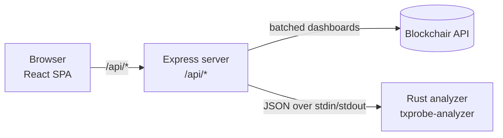

<div align="center">


# TxProbe

**See your Bitcoin transactions the way a chain analyst does.**


</div>

TxProbe is a Bitcoin transaction and address privacy analyzer. Give it a
transaction ID or a Bitcoin address and it runs the same chain-analysis
techniques that surveillance firms and blockchain forensics tools use. These include link
clustering, change-output detection, address reuse, coin mixing detection,
and more. It then reports back a 0 – 100 privacy score along with an
explanation of exactly what an outside observer could learn from that
transaction.

> [!IMPORTANT]
> TxProbe only ever reads public blockchain data, looked up by transaction ID
> or address. It never asks for, and has no way to use private keys, seed
> phrases, or wallet files.

---

## Running locally

TxProbe reads Bitcoin data from the [Blockchair API](https://blockchair.com/api).
Put your key in a `.env` file at the project root (it's git-ignored):

```bash
BLOCKCHAIR_API_KEY=your-key-here
```

Then:

```bash
cargo build --release      # the analyzer binary the server runs
npm install && npm start   # API server on :3001
cd web && npm install && npm run dev   # frontend on :3000
```

Tests: `cargo test`, `npm test` (server), and `cd web && npm test`.

---

## Why it matters

Bitcoin is pseudonymous, not anonymous. Every transaction is permanently
public, and a well-established set of heuristics lets chain analysts link
addresses together, identify which output in a payment is "change" versus
the actual payment, fingerprint wallet software, and build a picture of a
user's holdings and spending habits over time, all without ever knowing
their name. These techniques are well known to professional analytics firms
and largely invisible to everyday users, who typically have no way to see
their own transactions the way an observer would.

TxProbe closes that gap. It applies the same heuristics to a single
transaction, or across a sample of an address's recent history, and shows
you exactly what's leaking, how confident the detection is, and what an
observer would conclude. Therefore, you can make an informed decision about how you
transact, instead of learning about these patterns only after your privacy
has already been compromised.

---

## Architecture



- **Rust analyzer** (`src/`) — parses a raw transaction and its prevout data
  plus an optional one-hop graph context from stdin, runs the 15 heuristics
  below, and writes a JSON report to stdout. Invoked by the server as a subprocess.
- **Node/Express server** (`server.js`, `server/`) — fetches transaction,
  address and wallet data from the Blockchair API, rebuilds the raw
  transaction from it, gathers the one-hop graph context, pipes everything
  through the analyzer, and serves the built frontend. The API key never
  leaves the server.
- **React frontend** (`web/`) — paste a txid or address, see the privacy
  score, the detected heuristics, and a visual breakdown of inputs and
  outputs.

Every lookup goes through the server and is batched to keep API usage low:
transaction dashboards are fetched 10 per call and address histories 100 per
call. For each analyzed transaction the server also fetches its **one-hop
neighbourhood**: the transactions that created its inputs, the transactions
that spent its outputs, and the lifetime history of every address involved.
A single transaction costs about 2–5 Blockchair request points; scoring an
address's 20 latest transactions costs about 15–25.

Addresses and **wallets** (xpub, ypub or zpub) work the same way: the server
lists their latest transactions, and the browser submits the 20 most recent
for analysis in two batches of 10.

---

## Privacy heuristics

TxProbe checks every transaction against 15 heuristics. Each one detects a
specific pattern that a chain analyst could use to learn something about the
transaction's owner:

| Heuristic | What it detects |
|---|---|
| **Common Input Ownership (CIOH)** | Multiple inputs in one transaction, which analysts assume belong to the same wallet, linking those addresses together. |
| **Change Detection** | Which output is change returning to the sender versus payment going to the recipient, weighed from script type, value, output ordering, and fee/dust economics. The guess is then checked against how each output was spent next: confirmed (raised to high confidence) or corrected. |
| **Address Reuse** | The same output script appearing more than once within a transaction, or any input/output address that has received coins more than once across its lifetime history. |
| **CoinJoin Detection** | Three or more inputs paying repeated equal-value outputs above 10,000 sats, consistent with a CoinJoin mixing round. Flagged as a *positive* privacy signal, not a leak. |
| **CoinJoin Undone** | A coin carrying a parent CoinJoin's denomination spent together with other coins (other mixed coins or unmixed change), re-linking what the mix separated. |
| **Consolidation** | Three or more inputs merged into one or two outputs, confirming those inputs share an owner. |
| **Self-Transfer** | A single input to a single output, i.e. a wallet moving funds to itself. |
| **Peeling Chain** | A one- or two-input transaction whose two outputs differ by 10x or more, typical of a large UTXO being spent down gradually. The large remainder can be tracked through later transactions. |
| **OP_RETURN Data** | Embedded protocol data (Runes, Ordinals, etc.), which can tag the sender as a participant in that protocol. |
| **Round Number Payment** | Outputs that are exact multiples of 0.01 BTC, which are almost always payments rather than change, confirming which output is the payment. |
| **Locktime / RBF Analysis** | Locktime and sequence values that fingerprint the wallet software used. |
| **Inscription / Ordinal** | An Ordinals inscription or BRC-20 operation in the witness data. |
| **Unnecessary Inputs** | Inputs that could have been left out without underfunding the payment. A sign of suboptimal coin selection that reveals excess UTXOs. |
| **Script Type Upgrade** | Inputs that are all pre-SegWit (legacy P2PKH/P2SH, including P2SH-wrapped SegWit) paying to native SegWit or Taproot outputs, revealing a wallet mid-migration. |
| **Batch Payment** | Three or more spendable outputs, i.e. paying multiple recipients at once, exposing all of them in a single transaction. |

Each detected heuristic is shown with its confidence, what an observer
learns from it, and a suggestion for reducing the signal next time.

---

## How the privacy score is calculated

Every non-coinbase transaction starts at a baseline score of **100** (fully
private) and is adjusted based on which heuristics fire:

**Penalties**

| Signal | Penalty |
|---|---|
| Common input ownership detected (and it isn't a CoinJoin) | −20 |
| Inputs mix different script types | −10 |
| Address reuse detected | −30 |
| CoinJoin undone (mixed coin merged with other coins) | −25 |
| Change output identified, high confidence | −15 |
| Change output identified, medium confidence | −8 |
| Change output identified, low confidence | −3 |
| Outputs aren't BIP69-sorted (and it isn't a CoinJoin) | −5 |

**Bonuses**

| Signal | Bonus |
|---|---|
| CoinJoin detected | +40 |
| RBF (replace-by-fee) signaling | +5 |

The adjusted total is clamped to the 0–100 range. Coinbase transactions (the
block reward, with no real sender to protect) are excluded from scoring
entirely, and are reported with a score of `0`.

The resulting score maps to a label:

| Score | Label |
|---|---|
| 90–100 | Private |
| 75–89 | Guarded |
| 55–74 | Traceable |
| 35–54 | Exposed |
| 0–34 | Transparent |

> [!NOTE]
> Two other thresholds exist alongside those buckets: a score below 50 is
> flagged as low-privacy, and a score of 80 or above is treated as "clean."
> These are intentionally independent of the label boundaries above. They
> highlight different things in different parts of the UI, so don't expect
> the three to line up.
